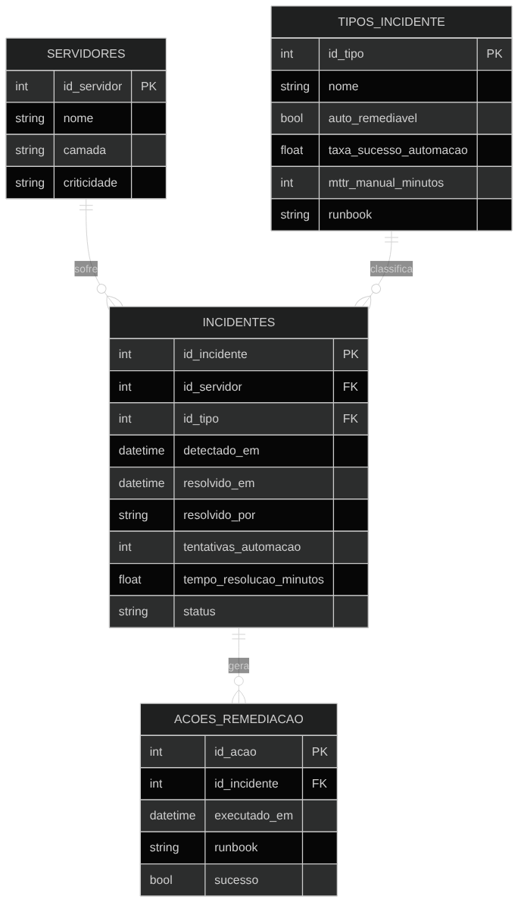
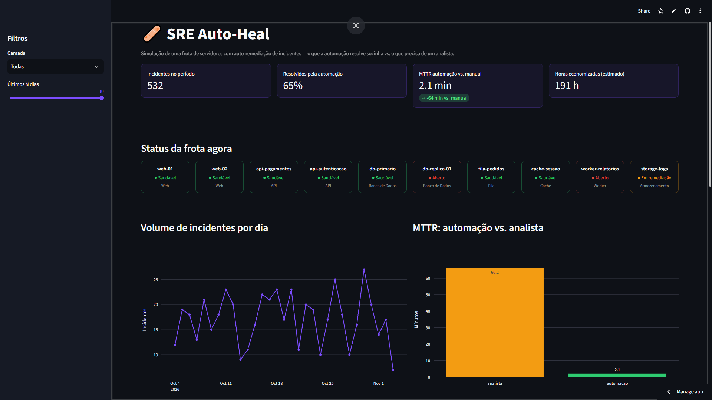

# 🩹 SRE Auto-Heal

[](https://github.com/euguisantosdev/sre-autoheal/actions/workflows/tests.yml)

Simulação de uma frota de servidores com **auto-remediação de incidentes**:
quando algo quebra, um motor de automação tenta resolver sozinho antes de
acionar um analista — e o painel mostra, com números, o quanto isso
realmente economiza.

## O problema real que isso ataca

Toda operação de suporte/sustentação em escala lida com o mesmo padrão:
a maioria dos incidentes que chegam pra um analista N1 são **repetitivos e
previsíveis** — serviço travou, disco encheu, certificado vai vencer. Isso
tem nome na indústria: **toil** (trabalho operacional manual, repetitivo e
automatizável) — o termo vem do *Google SRE Book*, e é um dos motivos pelos
quais existe hoje um mercado inteiro de ferramentas de **AIOps/auto-remediação**
(runbooks automáticos, auto-healing, self-service recovery). Empresas pagam
caro por isso porque cada minuto de MTTR (tempo médio de resolução) custa
dinheiro, e cada chamado repetitivo resolvido manualmente é um analista que
não está disponível pra um problema que realmente precisa de julgamento
humano.

Esse projeto simula exatamente essa dinâmica: uma frota de servidores sofre
incidentes realistas, um motor de automação tenta runbooks pré-definidos
pra resolver sozinho, e só escala pra um analista quando a automação não dá
conta — exatamente como um sistema de auto-remediação de verdade se
comporta (nenhuma automação resolve 100% dos casos, e fingir que resolveria
tornaria o projeto menos honesto, não mais impressionante).

## O que o projeto mostra

- **Modelagem de dados em SQL** — frota, catálogo de tipos de incidente,
  histórico de incidentes e o rastro de auditoria de cada tentativa de
  remediação automática (`sql/schema.sql`).
- **Motor de decisão** (`engine/motor.py`) — a lógica que decide se um
  incidente é resolvido pela automação ou escalado, com taxa de sucesso por
  tipo de problema e número máximo de tentativas antes de acionar um
  humano.
- **Catálogo de incidentes e runbooks** (`engine/catalogo.py`) — 9 tipos de
  incidente, a maioria auto-remediável (serviço travado, disco cheio,
  certificado expirando...) e dois propositalmente **não** auto-remediáveis
  (corrupção de dado, pico de erro sem causa clara) — porque isso é exatamente
  o tipo de decisão que um sistema de auto-remediação responsável precisa
  saber tomar: reconhecer quando NÃO deve tentar consertar sozinho.
- **Análise via SQL** — 9 queries respondendo perguntas reais de operação:
  taxa de auto-resolução, MTTR automação vs. analista, runbook com maior
  taxa de sucesso, horas economizadas (`sql/queries_analise.sql`).
- **Dashboard interativo** — status da frota em tempo real, feed de
  incidentes, comparação de MTTR e log de auditoria das ações automáticas
  (`app/dashboard.py`).

## Modelo de dados



## Estrutura

```
sre-autoheal/
├── README.md
├── requirements.txt
├── requirements-dev.txt        # dependências extras para rodar os testes
├── sql/
│   ├── schema.sql              # modelagem das tabelas
│   └── queries_analise.sql     # 9 queries de análise
├── engine/
│   ├── catalogo.py             # frota e catálogo de tipos de incidente
│   └── motor.py                # lógica de decisão: automação ou analista
├── data/
│   └── gerar_historico.py      # gera o banco SQLite com histórico fictício
├── app/
│   └── dashboard.py            # dashboard Streamlit
├── tests/                      # testes automatizados (pytest)
├── .github/workflows/
│   └── tests.yml                # roda os testes a cada push (GitHub Actions)
├── docs/
│   └── schema.png               # diagrama ER do banco
└── screenshots/
    └── dashboard.png
```

## Ver sem instalar nada

🔗 **[Abrir o dashboard publicado](https://sre-autoheal-kshs3a6xoqumaxswedgjat.streamlit.app/)**

O app gera o histórico fictício automaticamente na primeira execução, então
o link acima já abre com os dados prontos — sem precisar clonar nada.



## Como rodar localmente

Pré-requisito: Python 3.10+.

```bash
# 1. clonar o repositório
git clone https://github.com/euguisantosdev/sre-autoheal.git
cd sre-autoheal

# 2. instalar dependências
pip install -r requirements.txt

# 3. gerar o banco com o histórico fictício (cria data/autoheal.db)
python data/gerar_historico.py

# 4. subir o dashboard
streamlit run app/dashboard.py
```

O dashboard abre automaticamente em `http://localhost:8501`.

## Rodando os testes

```bash
pip install -r requirements-dev.txt
pytest tests/ -v
```

Os testes rodam automaticamente a cada push via GitHub Actions
(`.github/workflows/tests.yml`) — o badge no topo deste README mostra o
status da última execução. Eles cobrem: a lógica de decisão do motor de
automação (inclusive os casos-limite de 0% e 100% de taxa de sucesso), a
geração do histórico, a validade de todas as 9 queries de análise, e uma
regressão garantindo que um incidente marcado como **não** auto-remediável
nunca possa aparecer como resolvido pela automação — isso quebraria a
honestidade da métrica central do projeto.

## Dados

Todos os dados são fictícios, gerados por `data/gerar_historico.py` — não
há nenhuma infraestrutura real por trás. Mas o *modelo* não foi inventado
no vácuo: as taxas de sucesso de automação e os tempos médios de resolução
manual por tipo de incidente são estimativas plausíveis baseadas em
relatos públicos do setor de SRE/DevOps (Google SRE Workbook, relatórios de
incident management da indústria) — incidentes simples e bem definidos
(serviço travado, certificado expirando) têm taxa de automação alta;
incidentes que exigem julgamento humano têm taxa zero, de propósito.

A geração é determinística (seed fixa) e coberta por testes que travam as
regras de negócio — ver `tests/test_gerar_historico.py` e
`tests/test_motor.py`.

## Por que esse projeto

O primeiro projeto que publiquei (**[Service Desk Dashboard](https://github.com/euguisantosdev/service-desk-dashboard)**)
responde "o que aconteceu" — análise de chamados. Esse aqui é o passo
seguinte: "o que pode ser resolvido antes de virar chamado". É a mesma
pergunta que motiva qualquer time de sustentação madura a investir em
automação — reduzir o volume de trabalho repetitivo pra sobrar tempo pros
problemas que realmente precisam de uma pessoa pensando.

---
Guilherme dos Santos Bueno — Sorocaba/SP
